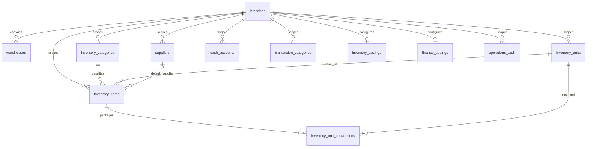

# Finance & Inventory implementation

## Scope and decisions (2026-11-07)

The latest official requirement is Single-Operator Workflow: create -> save -> immediate effect, with safe editing and cancellation of saved documents. This supersedes the original approval/posted-immutability design. The user request is the source for the new supplier-payable, inventory and cash-management rules. Existing Order, Payment, customer-debt and wash-batch rules are unchanged. The UI remains Solid Admin, explicitly confirmed by the user; Liquid Glass and ripple are excluded.

Phase 0 documents the complete target. Phase 1 implements branch-scoped master data, configuration, permission registration, audited changes, and real API-backed management screens. Phase 2 backend transaction/concurrency evidence is tracked in the linked verification report. Phases 3–4 remain unimplemented. No phase-1 endpoint changes stock, cash balances or payables.

## Phase 2 implementation (2026-11-08)

Inventory operations are now implemented in `inventory/operations` and `features/stock`, with additive V29–V31 migrations. The precise transactional, valuation, transit, permission, notification and Phase-3 contracts are in [INVENTORY_OPERATIONS.md](INVENTORY_OPERATIONS.md). Current execution evidence, remaining browser verification and manual acceptance steps are in [INVENTORY_PHASE2_VERIFICATION.md](INVENTORY_PHASE2_VERIFICATION.md).

The original foundation/target sections below retain design context. Inventory acceptance scenarios now have real integration/concurrency tests; cash/payable/settlement scenarios remain Phase 3 and NOT RUN. Overall responsive acceptance remains PARTIALLY VERIFIED until actual browser testing succeeds. No finance ledger/payable side effect is introduced by stock commands.

## Existing boundaries

Reuse the modular monolith, Spring method security, CurrentUserProvider branch scope, dynamic permission matrix, Flyway common migrations, React Query, effective backend permissions, i18next, shared Surface/Button/Field/OverlayDialog, motion and semantic theme tokens. Core Order and Wash Batch already exist. No new authentication, notification transport, database or frontend framework is required.

Inventory owns warehouses, suppliers, item categories, units, items, package conversions and inventory policy. Finance owns cash accounts, income/expense categories and finance policy. These master records are branch-scoped; a supplier in two branches is explicitly represented in both. No global supplier identity or cross-branch authority is inferred. Within an authorized branch there is currently no separate warehouse/account assignment model: effective capability plus branch scope defines access.

Master data is never hard deleted. Every update supplies an optimistic version; codes and branch ownership are immutable. Creation locks the existing branch row before allocating a per-kind sequential code, avoiding the race on a missing sequence row. Audit rows retain actor, entity ID, action, timestamp and changed field names, without supplier contact details or copied note contents. Lists use bounded pagination and deterministic ID ordering.

## Foundation ERD

Base units have an immutable dimension (COUNT, MASS, VOLUME). A package conversion references an input unit in the same dimension and stores a positive exact decimal factor into the item's base unit. Separate packages (can, carton, box) may use different factors. Editing a conversion later must never change recorded transaction snapshots. Base unit cannot change after item creation. Money is DECIMAL/BigDecimal, never float/double. Reference purchase prices are separate from actual inventory cost. Phase 1 has no cost/balance editing field.

Cash accounts begin at zero VND; opening balances require a separately authorized save-and-record operation in phase 3. Phase-1 account responses do not imply an operational cash ledger. Settings contain no approval switch or amount threshold. Defaults disallow negative stock/cash and use moving weighted average. Legacy approval columns remain unmapped compatibility data; V28 changes their insert defaults without rewriting old rows. Default warehouse/account references must be active and belong to the same branch. No default is silently created on GET.

## API contracts, permissions and UI

`/api/inventory/{warehouses,categories,units,suppliers,items,conversions}` and `/api/finance/{accounts,categories}` expose GET collection, GET detail, POST create and PUT versioned update. Requests carry branchId; list requests accept page, size (1–100), search and optional active. List responses contain items/page/size/totalElements/totalPages. Unknown or cross-branch referenced IDs are rejected. GET `/api/{inventory,finance}/settings` returns safe defaults with version -1 until saved; PUT creates/updates under a branch lock. GET `/api/{inventory,finance}/history` is separately authorized, paged and branch-scoped.

Inventory read/manage permissions are separated per master resource. Item purchase prices require `inventory.cost.read` to read and `inventory.cost.update` to write. Writes never grant cost read implicitly. Finance account/category/settings/history permissions are distinct. All phase-2/3 capabilities are registered in manifests now; granting one does not create an unimplemented endpoint. Explicit default grants are ADMIN/MANAGER; RECEPTIONIST receives only nonsensitive inventory catalog reads. DENY overrides ALLOW and roles everywhere.

The UI provides separate resource URLs, one query/filter/page state per page, mobile record lists, desktop comparison tables, a shared responsive edit dialog, dirty-close confirmation, nearby validation, success feedback and 403 handling. Reference selectors use paginated search rather than an unbounded catalog fetch. Settings have separate inventory and finance pages. No production mock data is used.

## Target transaction architecture (phases 2–4; not implemented by foundation)

## FINANCE & INVENTORY — SINGLE-OPERATOR WORKFLOW

The mandatory eleven rules are in root `AGENTS.md` under this exact title and apply to every subsequent phase. The current model has one operator. Do not introduce submission, approval, rejection, approver fields, amount thresholds or a second-person confirmation under another name. Add such a workflow again only if the project owner explicitly requests it.

Saving a valid official document records stock/cash/payable effects in the same transaction, with no second command or separate posting permission. Ordinary states are optional DRAFT, RECORDED and CANCELLED. Drafts have no effect and are never a mandatory first step. Physical transfer states may describe transit and receipt; they are not authorization gates.

Authorized users can edit a RECORDED document under its original code. Use immutable document revisions and optimistic versions, calculate exact deltas, and append linked correction/reversal ledger entries. The document is editable; historical ledger entries are immutable. A 5-to-7-litre receipt revision adds only 2 litres, and a cash expense revised from 500,000 to 450,000 restores only 50,000 to the fund. Cancellation applies the outstanding linked counter-effect once and sets CANCELLED, without deleting the document, allocations or history.

Before accepting a revision/cancellation, lock affected balances and dependencies, assess consumed stock, valuation, prior payments, returns and settlement allocations. Block only changes that cannot be handled safely, with a specific explanation and an alternative correction route. Do not silently produce negative balances, incorrect costs or overpaid liabilities. The operator performs corrections directly with the relevant effective edit/cancel permission; there is no approval step. If a closed period prevents modifying its economic figures, an authorized correction is recorded in an open period while retaining the source link and original period history.

Creation, revision and cancellation each retain actor/time/version and relevant before/after figures in audit. Idempotency protects each revision/cancellation as well as initial saves. A repeated identical command returns its original result; a stale or changed-payload retry conflicts. Branch/record scope and concurrency/integrity guarantees remain mandatory.

Inventory posting locks balance rows in sorted warehouse/item order. Ledger entries are authoritative; balance projections update in the same transaction. Receipts snapshot input unit, factor, base quantity, unit price, discounts, allocated acquisition charges and cost. Moving weighted average is per warehouse, using explicit decimal scales and residual allocation on the final line. Issues snapshot cost and never generate cash expenditure. Transfers link both movements atomically (a later transit workflow must use a distinct transit location). Stocktakes snapshot quantity and balance version; concurrent movement requires rebase/recount instead of overwriting current stock.

Inventory calls a Finance payable contract inside the same local transaction when posting a purchase or return. Receipt value creates liability independently of cash settlement. Supplier payment locks selected payables and cash account, validates outstanding amounts, allocates exactly once and posts one cash movement. A return reduces stock and liability; refunds are separate cash events. Advances require their own settlement balance rather than negative unidentified payables.

Cash posting locks account rows in sorted ID order. Transfer is one document and two ledger entries with zero net system movement, excluded from business income/expense. Reconciliation snapshots account balance/version and records discrepancy; any adjustment is a separately authorized document whose save records its effect immediately. No direct balance mutation API is permitted.

An idempotency key is unique by branch, command kind and source reference. Persist payload digest/result in the same transaction; replay returns the original result, changed-payload reuse conflicts. Database unique source links protect ledger posting even across request keys. Future order/payment/batch adapters carry source type/source ID, never create fake orders, and cannot duplicate an existing payment. Batch consumption links to the wash batch, not a fixed quantity per order.

Attachments reuse private validated storage through module-specific authorization; employee-private files are not shared by key. Notifications use after-commit events and existing recipient resolution, with unique event identity and source links. Export must use identical filters/scope and neutralize spreadsheet formulas. Reports distinguish inventory purchase value, consumption value, paid cash and remaining liability; net cash flow is never called profit.

## Verification gates and next phases

Foundation: test actual migration + schema validation, CRUD persistence, unit dimensions, reference scope, stale updates, code allocation, audit rollback, permissions/overrides and branch denial. Run all backend tests and Maven verify, permission generation/validation/drift tests, frontend typecheck/lint/unit tests/build. Verify UI on mobile first, including 390x600, then tablet and desktop, keyboard/touch/theme/language and loading/error/empty/long data. Report unavailable MySQL/browser checks explicitly.

Phase 2: inventory documents, stock ledger/balances, cost, transfers, stocktake, purchase payable contract, safe editing/cancellation of recorded documents; implement the supplied 10→15→12 and concurrent 8-of-10 scenarios. Phase 3: cash documents/ledger, direct-effect saves, safe revisions/cancellation, transfer, reconciliation, supplier allocations and partial payments. Phase 4: returns/reversals/period close, attachments, notifications, export/reports, transaction fault injection, MySQL concurrency and end-to-end hardening. Each phase must pass its gates before proceeding.

## Permission and API transition (V28)

Retire `document.submit`, `document.approve`, `document.post` and `document.reverse` under both Finance and Inventory from active manifests/generated constants. The eight existing database permissions and their assignments remain INACTIVE history. Register `finance.document.cancel` and `inventory.document.cancel`; default manifests grant them explicitly to ADMIN/MANAGER. On an existing database, copy actual reversal role grants and user overrides (including DENY, time windows and inactive status) to cancellation. Do not infer a cancellation grant from a role name or an old approval/posting grant. Existing revoked reversal grants stay revoked. Increment affected authorization/access/role versions. The dynamic matrix and effective-permission computation exclude inactive entries, and matrix/override edits preserve retired historical assignments while rejecting new assignment of inactive codes.

`document.update` covers safe editing of saved records, with HIGH Inventory and CRITICAL Finance risk. No runtime document endpoint is created by this transition. The foundation settings DTO now contains branchId/version/allowNegative/defaultResourceId plus response-only valuation/currency/time. It does not expose or require approval fields. Legacy incoming approval fields are explicitly ignored for rolling-client compatibility; they cannot change the workflow or retained columns. New settings audit events list only active configuration fields. Historical audit rows are retained and the UI labels retired configuration fields as legacy configuration.

Dirty catalog/configuration forms intercept explicit branch changes through a shared guard and show a cancellable unsaved-data dialog. Cancellation preserves both values and branch; confirmation discards the form and changes branch once. Pending saves block switching; stale/unmounted confirmations cannot change branch later. Authorization-driven removal of branch access remains immediate and is not delayed by a dirty-form prompt.

## Acceptance criteria and current verification (2026-11-08)

1. Save a valid stock/cash document without any approval or additional posting request; effects and audit commit immediately.
2. Optional draft save has no effect; an official save does not require an earlier draft.
3. Revise a saved receipt from 5 to 7 litres: append a net +2 correction, preserve its code, prior ledger and both revisions.
4. Revise a saved expense from 500,000 to 450,000: append a +50,000 cash correction once.
5. Retry initial save, revision or cancellation: return one effective movement/correction only.
6. Cancel a recorded document: append the correct counter-effect once, preserve provenance and audit; repeated cancellation cannot double-reverse.
7. Edit a purchase with partial/multiple settlements: preserve allocations and recalculate payable/cash effects without double payment; safely reject an impossible reduction with a specific alternative.
8. Edit/cancel after stock consumption, returns or later receipts: preserve valuation, prevent forbidden negative stock/cash and explain any unsafe correction.
9. Race two saves/revisions/cancellations: no lost update, duplicate movement or incorrect stock/cash/liability; injected failure rolls back all effects.
10. Effective DENY, missing permission, cross-branch IDs and period constraints remain enforced for all direct saves, edits and cancellations.

Inventory portions of 1–3, 5–6 and 8–10 now have executable integration tests: immediate saves/drafts, 5→7 revisions, replay/cancellation/dependency guards, two simultaneous receipts, two distinct operators issuing stock, receive/count races, rollback, DENY and branch isolation. See INVENTORY_PHASE2_VERIFICATION.md for exact scope/results; this does not claim a separate simultaneous-revision/cancellation stress test or production load capacity.

Cash/expense/payable portions, scenario 4 and scenario 7 remain Phase 3 and NOT RUN. A mocked Finance dependency guard test only verifies the integration boundary, not a payable implementation. Period closing remains deferred. Actual responsive/browser acceptance is still blocked while browser use is disabled; backend tests do not mark that gate VERIFIED.
