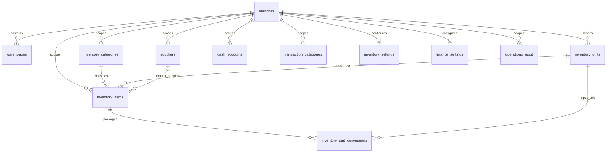

# Finance & Inventory implementation

## Scope and decisions (2026-11-07)

The user request is the source for the new supplier-payable, inventory and cash-management rules. Existing Order, Payment, customer-debt and wash-batch rules are unchanged. The UI remains Solid Admin, explicitly confirmed by the user; Liquid Glass and ripple are excluded.

Phase 0 documents the complete target. Phase 1 implements branch-scoped master data, configuration, permission registration, audited changes, and real API-backed management screens. Phases 2–4 must not be represented as implemented until their transaction and concurrency tests pass. No phase-1 endpoint changes stock, cash balances or payables.

## Existing boundaries

Reuse the modular monolith, Spring method security, CurrentUserProvider branch scope, dynamic permission matrix, Flyway common migrations, React Query, effective backend permissions, i18next, shared Surface/Button/Field/OverlayDialog, motion and semantic theme tokens. Core Order and Wash Batch already exist. No new authentication, notification transport, database or frontend framework is required.

Inventory owns warehouses, suppliers, item categories, units, items, package conversions and inventory policy. Finance owns cash accounts, income/expense categories and finance policy. These master records are branch-scoped; a supplier in two branches is explicitly represented in both. No global supplier identity or cross-branch authority is inferred. Within an authorized branch there is currently no separate warehouse/account assignment model: effective capability plus branch scope defines access.

Master data is never hard deleted. Every update supplies an optimistic version; codes and branch ownership are immutable. Creation locks the existing branch row before allocating a per-kind sequential code, avoiding the race on a missing sequence row. Audit rows retain actor, entity ID, action, timestamp and changed field names, without supplier contact details or copied note contents. Lists use bounded pagination and deterministic ID ordering.

## Foundation ERD

Base units have an immutable dimension (COUNT, MASS, VOLUME). A package conversion references an input unit in the same dimension and stores a positive exact decimal factor into the item's base unit. Separate packages (can, carton, box) may use different factors. Editing a conversion later must never change posted transaction snapshots. Base unit cannot change after item creation. Money is DECIMAL/BigDecimal, never float/double. Reference purchase prices are separate from actual inventory cost. Phase 1 has no cost/balance editing field.

Cash accounts begin at zero VND; opening balances require a separately authorized posted operation in phase 3. Phase-1 account responses do not imply an operational cash ledger. Settings default to required approval, zero approval threshold, no negative stock or cash, moving weighted average, and no closed date. Default warehouse/account references must be active and belong to the same branch. No default is silently created on GET.

## API contracts, permissions and UI

`/api/inventory/{warehouses,categories,units,suppliers,items,conversions}` and `/api/finance/{accounts,categories}` expose GET collection, GET detail, POST create and PUT versioned update. Requests carry branchId; list requests accept page, size (1–100), search and optional active. List responses contain items/page/size/totalElements/totalPages. Unknown or cross-branch referenced IDs are rejected. GET `/api/{inventory,finance}/settings` returns safe defaults with version -1 until saved; PUT creates/updates under a branch lock. GET `/api/{inventory,finance}/history` is separately authorized, paged and branch-scoped.

Inventory read/manage permissions are separated per master resource. Item purchase prices require `inventory.cost.read` to read and `inventory.cost.update` to write. Writes never grant cost read implicitly. Finance account/category/settings/history permissions are distinct. All phase-2/3 capabilities are registered in manifests now; granting one does not create an unimplemented endpoint. Explicit default grants are ADMIN/MANAGER; RECEPTIONIST receives only nonsensitive inventory catalog reads. DENY overrides ALLOW and roles everywhere.

The UI provides separate resource URLs, one query/filter/page state per page, mobile record lists, desktop comparison tables, a shared responsive edit dialog, dirty-close confirmation, nearby validation, success feedback and 403 handling. Reference selectors use paginated search rather than an unbounded catalog fetch. Settings have separate inventory and finance pages. No production mock data is used.

## Target transaction architecture (phases 2–4; not implemented by foundation)

Documents follow DRAFT -> PENDING_APPROVAL -> APPROVED -> POSTED; rejection returns through a versioned edit/resubmit path. Direct posting is permitted only by configured policy and explicit posting permission. Posted documents are immutable; reversal creates linked counter-entries, once only. Cancel applies before posting. Two-person approval and threshold enforcement occur on the server. Period close rejects backdated posting; corrections post in the next open period.

Inventory posting locks balance rows in sorted warehouse/item order. Ledger entries are authoritative; balance projections update in the same transaction. Receipts snapshot input unit, factor, base quantity, unit price, discounts, allocated acquisition charges and cost. Moving weighted average is per warehouse, using explicit decimal scales and residual allocation on the final line. Issues snapshot cost and never generate cash expenditure. Transfers link both movements atomically (a later transit workflow must use a distinct transit location). Stocktakes snapshot quantity and balance version; concurrent movement requires rebase/recount instead of overwriting current stock.

Inventory calls a Finance payable contract inside the same local transaction when posting a purchase or return. Receipt value creates liability independently of cash settlement. Supplier payment locks selected payables and cash account, validates outstanding amounts, allocates exactly once and posts one cash movement. A return reduces stock and liability; refunds are separate cash events. Advances require their own settlement balance rather than negative unidentified payables.

Cash posting locks account rows in sorted ID order. Transfer is one document and two ledger entries with zero net system movement, excluded from business income/expense. Reconciliation snapshots account balance/version and records discrepancy; any adjustment is a separately approved document. No direct balance mutation API is permitted.

An idempotency key is unique by branch, command kind and source reference. Persist payload digest/result in the same transaction; replay returns the original result, changed-payload reuse conflicts. Database unique source links protect ledger posting even across request keys. Future order/payment/batch adapters carry source type/source ID, never create fake orders, and cannot duplicate an existing payment. Batch consumption links to the wash batch, not a fixed quantity per order.

Attachments reuse private validated storage through module-specific authorization; employee-private files are not shared by key. Notifications use after-commit events and existing recipient resolution, with unique event identity and source links. Export must use identical filters/scope and neutralize spreadsheet formulas. Reports distinguish inventory purchase value, consumption value, paid cash and remaining liability; net cash flow is never called profit.

## Verification gates and next phases

Foundation: test actual migration + schema validation, CRUD persistence, unit dimensions, reference scope, stale updates, code allocation, audit rollback, permissions/overrides and branch denial. Run all backend tests and Maven verify, permission generation/validation/drift tests, frontend typecheck/lint/unit tests/build. Verify UI on mobile first, including 390x600, then tablet and desktop, keyboard/touch/theme/language and loading/error/empty/long data. Report unavailable MySQL/browser checks explicitly.

Phase 2: inventory documents, stock ledger/balances, cost, transfers, stocktake, purchase payable contract; implement the supplied 10→15→12 and concurrent 8-of-10 scenarios. Phase 3: cash documents/ledger, transfer, reconciliation, supplier allocations and partial payments. Phase 4: returns/reversals/period close, attachments, notifications, export/reports, transaction fault injection, MySQL concurrency and end-to-end hardening. Each phase must pass its gates before proceeding.
